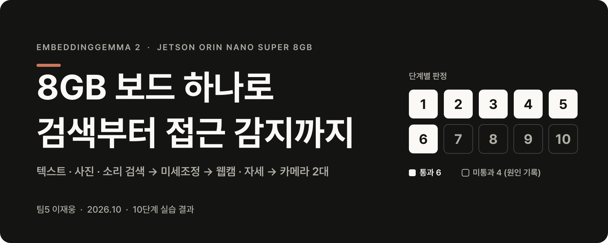

<p align="center">
  
</p>

<h1 align="center">EmbeddingGemma 2 실습 — 팀5 이재웅</h1>

<p align="center">
  <b>Jetson Orin Nano Super 8GB</b> 보드 한 대에서 <b>텍스트 검색부터 카메라 2대 접근 감지까지</b> 한 10단계 실습의 코드와 보고서
</p>

<p align="center">
  <a href="docs/presentation/eg2-practice-team5-jaeung.pdf"><b>📊 발표 자료 PDF</b></a>
  &nbsp;·&nbsp;
  <a href="docs/presentation/eg2-practice-team5-jaeung.pptx"><b>PowerPoint</b></a>
  &nbsp;·&nbsp;
  <a href="docs/presentation/eg2-practice-team5-jaeung-대본.md"><b>발표 대본</b></a>
  &nbsp;·&nbsp;
  <a href="docs/reports/"><b>단계별 보고서</b></a>
</p>

<p align="center">
  
  
  
  
</p>

같은 보드에서 공기 측정 서비스(11/05까지 꺼지면 안 됨)가 함께 돌았기 때문에, 실습 앱은 항상 메모리 제한을 걸고 켰고 학습은 맥에서만 했습니다. 실습 중 그 서비스가 꺼진 적은 없습니다.

---

## 결과 한눈에

| 단계 | 무엇 | 핵심 결과 | 판정 | 보고서 |
| :---: | --- | --- | :---: | --- |
| 1 | 환경 준비 | JetPack 7.2.1, Python 3.12, torch 2.14.1+cu132 | ✅ 통과 | [01](docs/reports/01-environment.md) |
| 2 | 패키지·모델 설치 | sentence-transformers 6.2.0, 768차원 벡터 확인 | ✅ 통과 | [02](docs/reports/02-packages-model.md) |
| 3 | 한국어 텍스트 검색 | 768·256·128차원 모두 정답 (질의 2개 154ms) | ✅ 통과 | [03](docs/reports/03-text-search.md) |
| 4 | 글로 사진 찾기 | 1·2차 5/6 → 3차 6/6 (사진 구성만 바꿈) | ✅ 3차 통과 | [04](docs/reports/04-vision-search.md) |
| 5 | 글로 소리 찾기 | 1차 4/6 → 2차 6/6 (합성 음성 → 실제 목소리) | ✅ 2차 통과 | [05](docs/reports/05-audio-search.md) |
| 6 | 성능 측정 | 텍스트 154ms, +비전 2302ms, 전체 3166ms, available 최저 1.7GB | ✅ 통과 | [06](docs/reports/06-performance.md) |
| 7 | 도메인 미세조정 | accuracy@1 0.700 → 0.717, 보드 일반 검색 5/6 (0.001 차) | ❌ 미통과 | [07](docs/reports/07-finetune.md) |
| 8 | 웹캠 물체 검색 | 세 모드 12fps, 기준 6개 중 5개 (전지 포장 실물 없음) | ❌ 미통과 | [08](docs/reports/08-webcam-search.md) |
| 9 | 사람 동작 인식 | GRU로 박수·팔짱, 행동 모델 9번 중 7번, 규칙 행동 패턴 4/12 | ❌ 미통과 | [09](docs/reports/09-pose.md) |
| 10 | 카메라 2대 접근 감지 | 앉아도 오차 0.14m, 알람 시나리오 5개 모두 3/3 | ❌ 미통과 | [10](docs/reports/10-proximity.md) |

미통과는 기준 하나나 두 개가 모자란 경우이고, 원인과 "다시 한다면"을 각 보고서에 적었습니다.

## 진행 원칙

| 원칙 | 내용 |
| --- | --- |
| 기준은 먼저, 그대로 | 단계마다 성공 기준을 실행 전에 적고, 결과를 본 뒤 바꾸지 않습니다 |
| 미통과는 다시 | 1차 기록은 남기고, 원인과 바꿀 것을 먼저 적은 뒤 자료·배치만 바꿔 2차·3차를 합니다 |
| 학습은 맥, 실행은 보드 | 보드가 학습 부하로 멈춘 적이 있어 7·9단계 학습은 맥에서 하고 모델 파일만 옮겼습니다 |
| 메모리 | `~/practice.sh`로만 실행(MemoryMax 2500M), 시작 전 available 3GB 미만이면 켜지 않음 |
| 평가 데이터 | `eval.jsonl`로 학습하거나 설정을 고르지 않습니다 |
| 개인정보 | 얼굴이 찍힌 사진·영상, 목소리 녹음은 끝나면 지우고 저장소에 올리지 않습니다 |

## 하드웨어와 환경

- 보드: Jetson Orin Nano Super 8GB, JetPack 7.2.1 (Ubuntu 24.04, Python 3.12), 전원 모드 MAXN SUPER
- 1~9단계는 보드 A, 10단계는 보드 B에서 팀원과 함께 (카메라 Logitech C920 2대)
- 실행 환경: 보드의 `~/eg2` venv, 저장소는 `~/eg2-재웅`에 clone
- 화면은 모니터 없이 노트북 브라우저로 봅니다 (Tailscale 주소에만 열림, 포트 8001)

## 실행 방법

```bash
cd ~/eg2-재웅 && git pull && source ~/eg2/bin/activate
free -h                                   # available 3GB 이상인지 확인
~/practice.sh 재웅 python test_text.py    # 실습 앱은 항상 practice.sh로
```

## 파일

| 단계 | 파일 | 내용 |
| :---: | --- | --- |
| 2 | `check.py` | 설치 확인 (GPU용 torch가 그대로인지) |
| 3~5 | `eg2.py` | 공통 로더 `load(vision=False, audio=False)` |
| 3 | `test_text.py` | 한국어 텍스트 검색, 768/256/128차원 비교 |
| 4 | `cam.py` | 웹캠 사진(`snap 이름`), 동영상+2초 프레임(`clip 초`) |
| 4 | `live.py` | 웹캠 실시간 보기와 버튼으로 사진 저장 (포트 8001) |
| 4 | `test_vision.py` | 텍스트로 사진·동영상 검색 (1위 자동 판정) |
| 5 | `make_audio.py` | 경보음·잡음 만들기, `raw_*`를 16 kHz 모노로 변환 |
| 5 | `test_audio.py` | 텍스트로 소리 검색 (1위 자동 판정) |
| 6 | `bench.py` | 구성별 RAM·지연·GPU 사용률 측정, 원문 표 출력 |
| 7 | `check_data.py` | 학습/평가 데이터 겹침 점검 (eval 점수는 안 봄) |
| 7 | `split_dev.py` | 학습 데이터에서 연습 시험(dev) 나누기 |
| 7 | `eval_ir.py` | accuracy@1/3/5·ndcg@10, 768/512/256/128차원 |
| 7 | `train_ft.py` | 미세조정 (맥에서만) |
| 8 | `app.py` | 웹캠 물체 추출·검색 (`--mode yolo`/`relabel`/`yoloe`) |
| 9 | `pose_app.py` | 사람 동작 인식 (`--raw`/기본/`--behavior`/`--record`/`--model`, 사진 저장 안 함) |
| 9 | `pose_model.py` | 관절 특징과 GRU 모델 |
| 9 | `train_pose.py` | GRU 학습 (맥에서만, 보드에서 켜면 멈춤) |
| 9 | `wave_check.py` | 손 흔들기 녹화로 손목 폭·판정 비율 진단 |
| 9 | `piece_check.py` | 행동 녹화의 끊김 없는 조각 수 세기 |
| 10 | — | 원문 코드로 보드 B에서 실행 (이 저장소에는 보고서만) |
| — | `docs/reports/NN-*.md` | 단계별 안내와 결과 보고서 |
| — | `docs/presentation/` | 발표 자료 (PPT · PDF · 대본) |

## 커밋하지 않는 것

비밀값(`.env`), 모델(`*.pt`, `*.safetensors`, `*.onnx`, `*.engine`), 데이터(`data/`), 사진·영상·소리(`media/`, `*.jpg`, `*.png`, `*.mp4`, `*.wav`)는 `.gitignore`로 막아 두었습니다.
